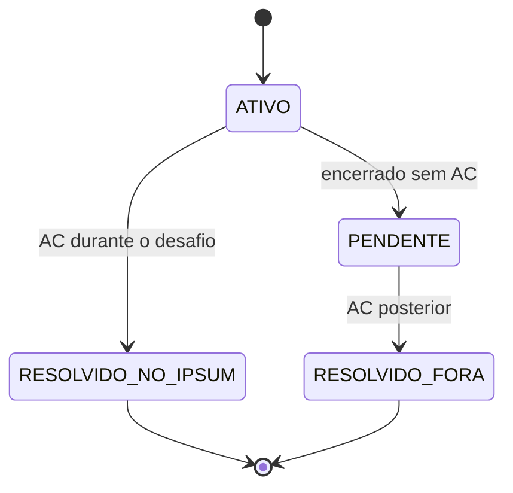

# Especificacao do produto Lorem

> Fonte de verdade para visao, escopo e regras funcionais estaveis. Consulte somente
> a secao relacionada a regra em alteracao. Progresso fica em [`ROADMAP.md`](ROADMAP.md)
> e escolhas em aberto ficam em [`DECISIONS.md`](DECISIONS.md).

## 2. Visao do produto

**Lorem** e um aplicativo Android de treino individual para programacao competitiva.

O aplicativo recomenda um exercicio inedito do Codeforces de acordo com o nivel do usuario, inicia um desafio cronometrado chamado **Ipsum**, acompanha as submissoes e produz feedback sobre dificuldade, tempo, uso de dica, rating e assuntos praticados.

### Problemas que o Lorem resolve

- O usuario nao quer escolher manualmente qual exercicio praticar.
- Exercicios aleatorios podem ser inadequados ao nivel atual.
- Resolver sempre os mesmos estilos cria uma falsa sensacao de dominio.
- O rating oficial do Codeforces depende de contests e nao mede diretamente o treino avulso.
- O usuario precisa aprender a administrar o tempo de resolucao.
- Problemas nao resolvidos precisam permanecer visiveis para estudo e upsolve.

### Publico principal

Competidores de nivel iniciante-intermediario ou intermediario que ja utilizam o Codeforces, desejam praticar com frequencia e querem feedback sobre sua capacidade real fora de contests.

### Promessa central

> Guiar o usuario por exercicios variados e adequados ao seu nivel ate que ele se torne confortavel com diferentes raciocinios em tempo de competicao.

### Prioridades do projeto

1. Fluxo completo do Ipsum funcionando.
2. Correcao dos dados e das regras.
3. Utilidade real para o treinamento.
4. Simplicidade de desenvolvimento e manutencao.
5. Aparencia visual.

---

## 3. Escopo fechado

**Alteracao aprovada em 19/10/2026 (Spark, D-039):** Historias 33-38
acrescentam Google/Firebase, varios handles por conta com 800 inicial e prazo de
2h. O app atual ainda usa perfil local e a regra inicial D-009. Contratos de
transicao/migracao e operacao sem rede: [FIREBASE.md](FIREBASE.md). Login 33/34 em preview; demais historias planejadas. Firebase sem Functions/Tasks/billing, com Rules e sincronizacao Android/WorkManager. O prazo de 2h e absoluto; a gravacao remota pode ocorrer depois, conforme rede/sistema/sessao. Veredito CF nao tem validacao independente no servidor neste escopo Spark.

### Dentro do escopo

- Conta Lorem identificada pelo uid Firebase, login exclusivamente Google e varios handles publicos por conta, com progresso separado por uid+handle (33-35). Handles repetidos entre contas sao permitidos, sem verificacao adicional de posse CF.
- Firestore para perfis, rating e Ipsums oficiais; Room/DataStore continuam como cache/configuracao e arquivo legado. Novo vinculo sempre inicia em 800; retornar a vinculo existente preserva seu rating (35-38).
- Consulta ao catalogo de problemas e ao historico de submissoes.
- Preparacao e atualizacao automatica dos dados publicos do Codeforces, conforme D-018 e Historias 15-17; novo bloco 33-38 acrescenta persistencia/recuperacao de progresso Firebase para a mesma conta, com transacoes/Rules Firestore e verificacao Codeforces no Android (D-039).
- Exclusao de qualquer exercicio ja tentado ou resolvido pelo usuario.
- Recomendacao automatica de um exercicio.
- Apenas um Ipsum ativo por conta Lorem, inclusive entre handles/dispositivos.
- Cronometro persistente, prazo absoluto de 2h e encerramento automatico sem AC quando nao houver AC valido na janela (36-37).
- Tags escondidas, com opcao de revela-las como dica.
- Verificacao das submissoes feitas durante o Ipsum.
- Resultado e alteracao do rating interno.
- Historico de resolvidos durante Ipsums.
- Lista de problemas encerrados sem AC.
- Deteccao de AC obtido posteriormente, fora do Ipsum.
- Estatisticas por rating, tempo, resultado, dica e tags oficiais do Codeforces.
- Recomendacao que favorece variedade e pontos fracos.
- Indicacao de consolidacao da faixa de rating.
- Interface Compose com temas claro/escuro e navegacao organizada, conforme proposta D-019 e Historias 18-21.
- Estudo reproduzivel em Python de tempo ate AC e probabilidade com orcamento
  explicito, conforme [QUANTITATIVE.md](QUANTITATIVE.md) e Historias 22-28.
- Corte verificavel de problemas nas novas recomendacoes (29) e validacao posterior
  com Ipsums e relacao Rating CF/Lorem (30-31); integracao local condicionada (32).

### Fora do escopo

- Equipes, duelos ou ranking entre usuarios.
- Contests, simulados ou treinos coletivos dentro do aplicativo.
- Chat, editorial ou geracao de dicas por inteligencia artificial.
- Tags criadas manualmente pelo Lorem.
- Editor ou compilador de codigo dentro do aplicativo.
- XP, moedas, streaks, conquistas ou loja.
- Login por senha, anonimo ou provedores diferentes do Google; verificacao adicional de posse CF e exclusividade global de handle.
- Backend proprio fora dos servicos Firebase/Google necessarios ao bloco 33-38; sincronizacao generica de conflitos e novos treinos oficiais offline.
- Recursos especulativos apresentados como "versao futura".
- Comparacao entre epocas, analises por ano e correcao temporal dos ratings.

---

## 4. Glossario e regras de dominio

- **Lorem:** o aplicativo inteiro.
- **Ipsum:** uma tentativa oficial e cronometrada de resolver um problema recomendado.
- **Rating Lorem:** estimativa interna da capacidade individual do usuario fora de contests.
- **Rating Codeforces:** dificuldade atribuida pelo Codeforces a um problema ou rating competitivo oficial do usuario. Nao confundir com o Rating Lorem.
- **Dica de topicos:** revelacao das tags oficiais do problema no Codeforces.
- **Tentado anteriormente:** problema que possui qualquer submissao anterior ao inicio do Ipsum, com qualquer veredito.
- **Resolvido no Ipsum:** primeira submissao com veredito final AC foi enviada entre o inicio e a fronteira efetiva do Ipsum (encerramento antecipado ou prazo de 2h); deteccao tardia nao altera seu horario real.
- **Encerrado aguardando verificacao (37):** prazo ja terminou e treino nao pode continuar, mas API incompleta/veredito pendente adia o resultado e saldo definitivos; nao equivale a ativo nem a ausencia comprovada de AC.
- **Pendente:** Ipsum encerrado sem AC.
- **Resolvido fora do Ipsum:** problema pendente que recebeu AC posteriormente.
- **Rating estimado:** valor numerico calculado pelas tentativas recentes.
- **Faixa consolidada:** maior faixa na qual o usuario demonstrou consistencia e variedade suficientes.

### Identidade de um problema

Sempre identificar um problema pela combinacao estavel fornecida pelo Codeforces, preferencialmente `contestId + index`. Nunca usar apenas o nome.

### Estados permitidos de um Ipsum



A Historia 37 acrescentara `CLOSED_AWAITING_VERIFICATION` para separar fechamento
no prazo de confirmacao do resultado; o diagrama acima representa os estados
atuais/finais. AC enviado depois da fronteira e somente upsolve.

Regras invariantes:

- So pode existir um Ipsum ativo por uid; tentativa encerrada aguardando verificacao bloqueia novo inicio ate confirmar o saldo.
- Todo vinculo novo uid+handle inicia em 800, sem usar rating CF como saldo Lorem.
- Prazo absoluto de 2h nao pausa nem reinicia; timeout sem AC usa fim no prazo e delta D-012 uma unica vez.
- A regra temporal nova nao reavalia Ipsums antigos ja encerrados.
- Submissoes anteriores ao inicio nunca contam para o Ipsum atual.
- Um Ipsum encerrado nao pode alterar o rating pela segunda vez.
- Resolver posteriormente move o item de lista, mas nao reavalia o rating original.
- Rating, tags e categoria do sorteio ficam escondidos enquanto o Ipsum esta ativo.

---

## 5. Regras confirmadas de recomendacao

Considere `R` como o Rating Lorem atual.

### Distribuicao de dificuldade

- 1/3 de chance de **fluencia**: `max(800, R - 200)` ou `max(800, R - 100)`.
- 1/3 de chance de **nivel atual**: aproximadamente `R`.
- 1/3 de chance de **desafio**: `R + 100` ou `R + 200`.

A categoria sorteada nao deve ser mostrada durante o Ipsum.

### Filtros obrigatorios

O problema precisa:

- possuir rating;
- ter contest de origem com inicio verificavel em ou apos `2020-07-01T00:00:00Z`;
- nunca ter recebido submissao anterior do usuario;
- nunca ter participado de outro Ipsum;
- nao estar pendente;
- nao ser o problema do Ipsum ativo.

O corte foi implementado na Historia 29 em 18/10/2026, com prova de contest.list
persistida e versionada no catalogo e nos novos snapshots.
Usar a data do contest, nunca o identificador como aproximacao. Origem/data nao
verificavel torna o problema inelegivel. Preservar qualquer historico antigo,
avaliacao, pendencia ou Ipsum ativo; tentativas antigas continuam impedindo repeticao.
Cache verificado deve permitir uso local; fallback nao relaxa o corte. O mesmo
recorte se aplica a base do estudo, sem limitar a importacao do historico do app.

### Prioridade de variedade

Depois dos filtros e da faixa de dificuldade, favorecer nesta ordem:

1. tags nunca praticadas;
2. tags pouco praticadas;
3. tags com maior taxa de falha;
4. tags nas quais o usuario usa dica com frequencia;
5. tags ja dominadas.

Usar apenas tags oficiais do Codeforces. Um problema com varias tags contribui para todas elas. A IA nao deve inventar uma taxonomia paralela.

### Quando nao houver candidato exato

Nao retornar erro imediatamente. Procurar progressivamente nos ratings vizinhos em passos de 100, mantendo todos os filtros de ineditismo. Registrar qual fallback foi utilizado. Os limites exatos desse fallback ainda estao em **Decisoes abertas**.

---

## 6. Dados minimos a preservar

Os nomes tecnicos podem mudar, mas o sistema precisa representar:

- **Conta/vinculo (33-38):** uid Firebase, handle canonico/chave normalizada, Rating Lorem inicialmente 800, faixa consolidada, versao do progresso e ultima sincronizacao.
- **Prazo (37):** inicio e expiresAt do servidor, versao temporal, encerramento efetivo, processedAt e estado de verificacao; cache sempre identificado por uid+handle.
- **Problema:** `contestId`, `index`, nome, rating, tags e URL.
- **Elegibilidade (29):** inicio/fonte do contest de origem e versao da regra;
  cache legado sem data nao habilita novos candidatos ate verificacao.
- **Ipsum:** problema, rating inicial, categoria, horarios, estado, dica, submissoes, erros, tempo, motivo do fracasso, variacao de rating e eventual AC posterior.
- **Desempenho por tag:** tentativas, AC no Ipsum, pendencias, uso de dica, tempo medio e faixa de rating.

---

## 7. Base tecnica recomendada

Opcao inicial para manter o TCC simples; preservar outra estrutura se o repositorio ja possuir uma funcional:

- Kotlin, Compose, um modulo, ViewModel + StateFlow e Coroutines.
- Room para cache/dados locais legados e DataStore para pequenas configuracoes; bloco 33-38 acrescenta Firebase Auth Google e Firestore no Spark, com transacoes/Rules e WorkManager para reconciliacao (D-039). Verificacao Codeforces e calculo no Android; sem Functions/Tasks/billing.
- Cliente HTTP centralizado, Navigation Compose e injecao manual simples.
- Sem Hilt ou backend proprio apenas por padrao.

### Endpoints necessarios do Codeforces

- `user.info`: validar e carregar o usuario.
- `user.status`: importar e atualizar submissoes.
- `problemset.problems`: carregar problemas, ratings e tags.

Extensao planejada: `contest.list` para datas verificaveis (estudo e Historia 29);
`contest.standings`, `contest.status`, `contest.ratingChanges` e, quando necessario,
`user.rating` no estudo Python. Estes endpoints novos ainda nao estao implementados
no aplicativo. O subprojeto Python sera separado e nao e requisito de runtime Android.

A API publica retorna `OK` ou `FAILED` e permite no maximo uma chamada a cada dois segundos. Centralizar chamadas e limitar a frequencia; nao deixar cada tela consultar livremente.

### Comandos de verificacao esperados

Este repositorio nao versiona o Gradle Wrapper para evitar artefatos binarios. Use Gradle 8.11 ou superior com Java 17:

```bash
gradle test
gradle lint
gradle assembleDebug
```

No Windows sem WSL, use os mesmos comandos em um terminal no qual o Gradle esteja disponivel no `PATH`.

---

## 13. Metodo de avaliacao do TCC

Antes e depois de um periodo de uso, avaliar: exercicios tentados, AC durante Ipsums, tempo medio, AC sem dica, variedade de tags, desempenho por rating, upsolves e percepcao sobre confianca e controle do tempo.

Nao afirmar que o Lorem melhora aprendizagem apenas com base em rating interno. Separar metricas objetivas de percepcao subjetiva e documentar as limitacoes da avaliacao.

### Extensao quantitativa planejada

Estimar tempo ate AC e `P(AC ate b)` com `b` explicito (30/60/120 min inicialmente),
usando rating anterior ao contest (`oldRating`) e rating do problema. Registrar a
diferenca e tratar tempo sequencial como aproximacao. Preservar tentativas sem AC
e observacoes incompletas com estados distintos; usar censura e medir cobertura.
Referencias simples precedem modelo interpretavel; medir erros de tempo,
calibracao/probabilidades e incerteza com contests completos reservados e sem
features de desfecho. Protocolo em [QUANTITATIVE.md](QUANTITATIVE.md).

A primeira entrega e o estudo reproduzivel, sem resultado empirico comprovado neste
planejamento. Aplicacao ao Lorem exige validar Ipsums e a relacao entre Rating CF
anterior e Rating Lorem inicial, sem pressupor equivalencia. Qualquer integracao
deve ser local, versionada e preservar avaliacoes antigas; D-012 permanece vigente
ate decisao explicita posterior. O estudo/modelo nao exige backend, login ou
nuvem; a conta e os dados oficiais do app passam a ser planejados em Firebase
pelo bloco independente 33-38, sem habilitar previsoes da 32.

---

## Referencias metodologicas

Esta documentacao aplica instrucoes persistentes, desenvolvimento orientado por
especificacao, criterios de aceite, checklists verificados, registro de decisoes e
pequenas entregas verticais.

- OpenAI, `AGENTS.md`: https://learn.chatgpt.com/docs/agent-configuration/agents-md
- GitHub Spec Kit: https://github.com/github/spec-kit
- GitHub, instrucoes para agentes: https://docs.github.com/en/copilot/how-tos/copilot-on-github/customize-copilot/add-custom-instructions/add-repository-instructions
- GitHub, task lists: https://docs.github.com/en/get-started/writing-on-github/working-with-advanced-formatting/about-tasklists
- Codeforces API: https://codeforces.com/apiHelp
