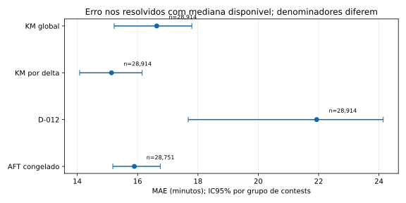
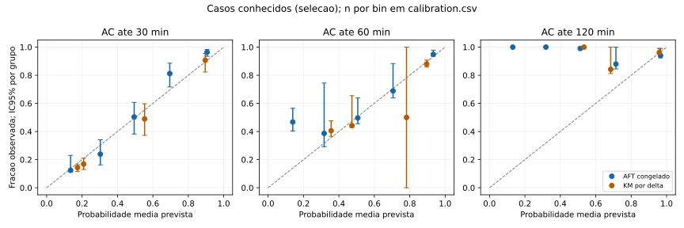
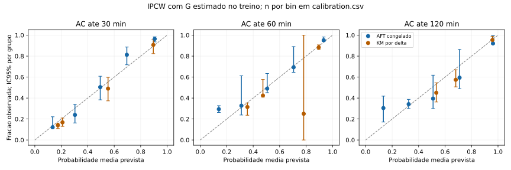

# Estudo quantitativo do Lorem

Dados: **real**. KM por delta teve Brier integrado menor que o AFT nesta amostra, inclusive no IC pareado.

## Populacao e metodo

19 contests elegiveis; 392445 tentativas observadas; 234945 eventos, 39128 censuras, 118372 exclusoes. Cobertura: 0.698.

Contests especiais e qualquer contest com problemas em duas versoes foram excluidos integralmente. Amostra estrutural congelada antes dos desfechos; rating de problemas observado na coleta. Populacao: participantes oficiais individuais com oldRating positivo e prefixo sequencial valido.

Teste reservado: [1492, 1848, 1936, 2165]; 4 grupos inteiros, 35367 tentativas, 28914 eventos e 6453 censuras. Treino/validacao/teste: b954ae933f1909ae6f3931381cb7bf9fd7f2d73862183ab1f83b0ee6c4f534d6.

Linhas fora do dominio de ratings do AFT: 1; incluidas com ressalva de extrapolacao. D-012 recebe oldRating Codeforces como referencia experimental de tempo; esta tabela nao mede o erro do aplicativo usando Rating Lorem.

AFT escolhido apenas na validacao: weibull:0.1; hash 2bb92b581b909e9a6b95002d99a4e2602e2b0c2309f7df81b0a4184b55b7899f. Entradas: oldRating e delta, sem resultados futuros. Likelihood inclui censuras. Nenhum modelo foi retunado no teste. G marginal e transformacoes usam apenas treino.

## Erros de tempo nos resolvidos

Denominadores diferem por suporte da mediana. Ha vies de selecao: esses erros nao representam os nao resolvidos. Valores em minutos; colchetes sao IC95% por grupo.

| Modelo | n | MAE | Mediana absoluta | RMSE | Vies previsto-observado |
|---|---:|---|---|---|---|
| AFT congelado | 28751 | 15.892 [15.179, 16.751] | 9.732 [9.590, 10.020] | 24.370 [23.039, 26.181] | 4.649 [0.876, 7.786] |
| D-012 | 28914 | 21.936 [17.677, 24.142] | 19.400 [15.133, 21.883] | 27.549 [22.369, 29.194] | 16.171 [10.031, 20.213] |
| KM por delta | 28914 | 15.135 [14.078, 16.151] | 9.183 [8.400, 10.433] | 22.046 [21.017, 22.788] | 0.698 [-5.618, 4.683] |
| KM global | 28914 | 16.633 [15.223, 17.797] | 13.017 [11.100, 13.600] | 22.513 [20.073, 24.597] | -4.699 [-10.761, 0.246] |

## Probabilidades e censura

Brier menor indica menor erro. Casos censurados antes de b sao desconhecidos; nunca negativos. IPCW usa todas as tentativas no denominador, com G do treino e minimo 0,05. Integracao: grade 0-120 min em passos de cinco, limitada ao prefixo suportado. D-012 nao possui probabilidade.

| Modelo | Brier integrado | Brier IPCW 30 | 60 | 120 |
|---|---|---|---|---|
| AFT congelado | 0.127 [0.106, 0.136] | 0.160 [0.151, 0.182] | 0.142 [0.124, 0.159] | 0.108 [0.039, 0.138] |
| D-012 | indisponivel | indisponivel | indisponivel | indisponivel |
| KM por delta | 0.123 [0.102, 0.131] | 0.164 [0.150, 0.193] | 0.140 [0.113, 0.155] | 0.092 [0.027, 0.117] |
| KM global | 0.164 [0.116, 0.172] | 0.252 [0.238, 0.267] | 0.188 [0.128, 0.202] | 0.098 [0.024, 0.127] |

Brier/log-loss conhecidos, bins com n/IC e fatias de ambos os ratings/delta estao nos CSVs. Log-loss limita apenas o argumento do log em 1e-15. Calibracao IPCW pode exceder um sem truncamento.

| Horizonte | Conhecidos | Desconhecidos | G(b-) | Maior peso | IPCW disponivel |
|---|---:|---:|---:|---:|---|
| 30 | 35252 | 115 | 0.995 | 1.005 | True |
| 60 | 34290 | 1077 | 0.938 | 1.066 | True |
| 120 | 30865 | 4502 | 0.497 | 2.010 | True |

## Diferencas pareadas e intervalos preditivos

Diferenca AFT menos referencia no mesmo suporte; negativo favorece AFT para erros/Brier. 200 replicacoes de grupos inteiros com reposicao, seed do split; IC percentil 95%. Com apenas poucos grupos, ICs podem ser instaveis e nao incluem incerteza do ajuste.

| Referencia | Delta MAE (n comum) | Delta Brier integrado |
|---|---|---|
| aft_minus_d012 | -5.716 [-8.647, -0.489] (n=28751) | indisponivel |
| aft_minus_km_delta | 0.952 [0.599, 1.914] (n=28751) | 0.004 [0.002, 0.008] |
| aft_minus_km_global | -0.732 [-1.272, 1.251] (n=28751) | -0.037 [-0.043, -0.009] |

Intervalos preditivos 10/90 descrevem variacao de tempo; IC95% descreve incerteza das metricas. Cobertura apenas em resolvidos com ambas as pontas disponiveis tem vies e nao mede cobertura populacional.

| Modelo | n | Cobertura | Largura media (min) |
|---|---:|---|---|
| AFT congelado | 26299 | 0.957 [0.952, 0.964] | 67.297 [64.472, 74.022] |
| D-012 | 0 | indisponivel | indisponivel |
| KM por delta | 23335 | 0.910 [0.884, 0.926] | 53.871 [50.505, 56.404] |
| KM global | 28914 | 0.932 [0.883, 0.987] | 136.817 [136.817, 136.817] |

## Sensibilidade e limites

Observacao alternativa ate ultima submissao: treino n=193527, teste n=35367, ausentes=0. Previsoes ficam fixas e G e reestimado somente no treino alternativo. Isso muda a hipotese de observacao, sem medir dedicacao efetiva e sem escolher a regra pelo teste.

| Modelo | Brier integrado alternativo |
|---|---|
| AFT congelado | 0.105 [0.098, 0.114] |
| D-012 | indisponivel |
| KM por delta | 0.104 [0.094, 0.113] |
| KM global | 0.135 [0.117, 0.142] |

- Sequential wall-clock approximation, not effective dedication
- Event-only time and interval scores favor solved attempts; each denominator is explicit
- Known-case scores/calibration are selected; censored-before-budget outcomes remain unknown
- IPCW assumes independent censoring with a marginal train-only censoring curve
- Bin IPCW estimates can exceed one; no clipping of weights or observed fractions
- Intervals are predictive 10/90 quantiles; CI95 is uncertainty of evaluation metrics
- Participants repeat across contests; group bootstrap does not remove participant dependence
- Problem ratings are from collection; missing ratings and selected prefixes limit coverage
- No temporal correction, pedagogical claim, or transport validation for Ipsums

## Consulta demonstravel e decisao

Dois ratings 1200/1600 e orcamentos 30/60/120 -> demo.json, com probabilidades, mediana, quantis e suporte. Ponta indisponivel permanece null. Consulta ilustrativa nao e acerto individual.

KM por delta teve Brier integrado menor que o AFT nesta amostra, inclusive no IC pareado. O candidato congelado e preservado; este teste nao e usado para retuning. Manter D-012 no aplicativo e ratings distintos. Integracao permanece bloqueada ate a validacao em Ipsums. Nao ha evidencia de melhoria pedagogica ou de transporte para treino individual.

Novo experimento exigira nova amostra reservada e protocolo previo; diagnosticar calibracao/abandono antes de aumentar complexidade. A proxima base deve registrar CF anterior, Lorem inicial, inicio, AC/encerramento, dicas e interrupcoes, com particoes por participante (Historias 30-31).

## Reproducao

Seguir study/README.md e REPRODUCE.md. Snapshot/cache bruto local e necessario para bytes identicos. Nenhum handle ou identificador de participante e publicado. Manifesto lista hashes dos agregados, versoes e seeds; tempos/custo da coleta estao na evidencia da amostra.
